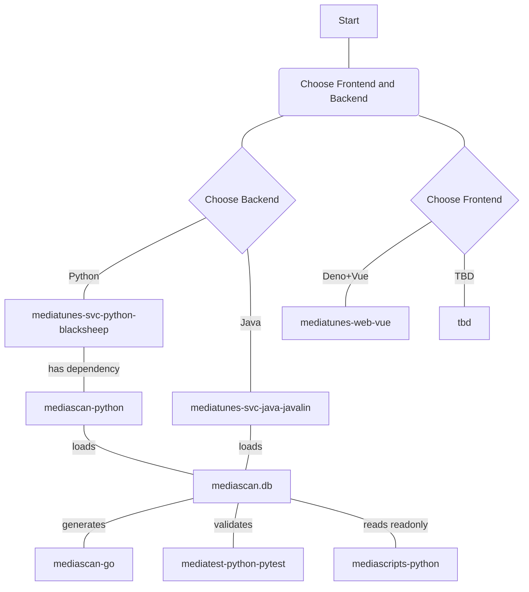

## Moongas mediatunes API Service (Java+Javalin implementation)

> 🚧 **Status: Work in Progress (WIP)**  
> This project is currently under active development. Features, APIs, and documentation are subject to change.

---

## Overview

**Lightweight music collection server. Java+Javalin port of the original Python+BlackSheep implementation
([moongas-mediatunes-svc-python-blacksheep](https://github.com/moongas-org/moongas-mediatunes-svc-python-blacksheep)),
serving the same JSON API from a mediascan SQLite database.**

### A component of the `moongas` ecosystem of media library tools

- [moongas-collection-demo](https://github.com/moongas-org/moongas-collection-demo) [](https://github.com/moongas-org/moongas-collection-demo/actions/workflows/ci.yml) - Example Moongas media collection (metadata only)
- [moongas-mediatunes-web-vue](https://github.com/moongas-org/moongas-mediatunes-web-vue) [](https://github.com/moongas-org/moongas-mediatunes-web-vue/actions/workflows/ci.yml) - A Deno-tooled TypeScript/Vue SPA for Moongas hybrid media collections, pairing with the separate moongas-mediatunes-svc-python-blacksheep backend to seemlessly blend offline and streaming playback
- [moongas-mediatunes-svc-python-blacksheep](https://github.com/moongas-org/moongas-mediatunes-svc-python-blacksheep) [](https://github.com/moongas-org/moongas-mediatunes-svc-python-blacksheep/actions/workflows/ci.yml) - Python+BlackSheep implementation of API service for Moongas hybrid media collections—backend for Moongas mediatunes web application (moongas-mediatunes-web-vue)
- [moongas-mediatunes-svc-java-javalin](https://github.com/moongas-org/moongas-mediatunes-svc-java-javalin) [](https://github.com/moongas-org/moongas-mediatunes-svc-java-javalin/actions/workflows/ci.yml) - Java+Javalin implementation of API service for Moongas hybrid media collections—backend for Moongas mediatunes web application (moongas-mediatunes-web-vue)
- [moongas-mediascan-go](https://github.com/moongas-org/moongas-mediascan-go) [](https://github.com/moongas-org/moongas-mediascan-go/actions/workflows/ci.yml) - Golang module to scan media collections and Moongas Yaml metatadata, outputs Moongas database
- [moongas-mediascan-python](https://github.com/moongas-org/moongas-mediascan-python) [](https://github.com/moongas-org/moongas-mediascan-python/actions/workflows/ci.yml) - Python library with data classes for loading Moongas mediascan databases and Yaml metadata files
- [moongas-mediascripts-python](https://github.com/moongas-org/moongas-mediascripts-python) [](https://github.com/moongas-org/moongas-mediascripts-python/actions/workflows/ci.yml) - Python scripts for working with Moongas media collections.
- [moongas-mediatest-python-pytest](https://github.com/moongas-org/moongas-mediatest-python-pytest) [](https://github.com/moongas-org/moongas-mediatest-python-pytest/actions/workflows/ci.yml) - Python tool for enforcing media collection rules (implemented with `pytest`)



## Configuration

Configuration is loaded from a YAML file passed as the first command line
argument (or from the `MEDIATUNES_CONFIG` environment variable). See
[mediatunes-config.yml](mediatunes-config.yml) for the available options.

## Album queries

`GET /api/albums` reads names, years and cover directories directly from the
`album` table. Related tracks and artists are left-joined to support filters
for `artist`, `albumartist`, `title`, `genre`, `countryCode`, `regionCode`,
`city` and `languageCode`. Combined track/artist filters must match the same
related track. Results contain one entry per album path, including albums
without tracks when no track/artist filter excludes them.

Each entry includes `artist`, `album`, `year`, `coverPath` and boolean
`explicitCover`. The explicit-cover flag comes from the album's metadata.

The `album`, `year`, `minYear` and `maxYear` filters on this endpoint use album
metadata, not track tags. List filters are repeatable, also accept `[]` suffixes,
and match case-insensitive substrings. For example:

```text
/api/albums?countryCode=US&genre=Rock&explicitCover=false&sort=year
```

String list filters (`artist`, `albumartist`, `album`, `title`, `genre`, `year`,
`countryCode`, `regionCode`, `city` and `languageCode`) use this matching
throughout the API. Repeated values match any value, so
`artist=wu-tang&artist=dr.+dre` matches "Wu-Tang Clan". Different filter fields
must all match. For an exact year, use the same `minYear` and `maxYear` value.

`explicitCover` is an optional scalar boolean accepting `true`, `false`, `1`
or `0` (case-insensitive). Invalid or blank values return HTTP 400. It also
filters `/api/tracks`, `/api/random-track`, `/api/artists` and `/api/album`
through the track's album path.

Like the Python service, `GET /api/album` selects the first album whose tracks
match the filters; its `album` and year filters still refer to track tags.
It returns `id`, `path`, `name`, `year` and boolean `explicitCover`.
If the database lacks an `album` table, `/api/albums` returns an empty list,
`/api/album` returns HTTP 404, and track queries without `explicitCover` still work.

## Track queries

`GET /api/tracks` applies `maxResults` after filtering and sorting, including
requests filtered by artist or album. Zero or negative values mean unlimited
results, as with `maxResultsAlbumCovers`. This limit does not restrict the
candidates used by `/api/random-track`.

The response includes `files`, `coverPath` and an `album` field. When every
matching track (before the result limit) belongs to the same album directory,
`album` contains its metadata in the same shape as `/api/album`
(`id`, `path`, `name`, `year`, `explicitCover`). Otherwise, or when metadata is
missing, it is `null`. At most one album lookup is performed per request.

## Running

```
./gradlew mediatunes-svc:run --args="mediatunes-config.yml"
```

### Testing

```
./gradlew mediatunes-svc:test
```
